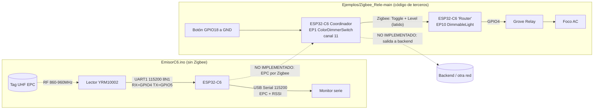

# Auditoría técnica — prototipo-convergente-iot (ESP32-C6 + Zigbee + RFID)

- Fecha: 2026-11-24
- Alcance: auditoría de solo lectura del repositorio (`main`, 4 commits) y del core Arduino-ESP32 instalado localmente (3.3.8) para contrastar el comportamiento de la librería Zigbee.
- No se compiló, cargó ni probó nada en hardware. **Todo lo que dependa de comportamiento en ejecución es sospecha, no hecho comprobado.**

Leyenda de evidencia: **[COMPROBADO]** = visible en código/config; **[SOSPECHA]** = requiere prueba en hardware; **[INFERIDO]** = deducido, sin documentación que lo confirme.

---

## 1. Identificación y descripción del proyecto

### Objetivo (INFERIDO)
No existe README del proyecto raíz ni descripción del objetivo. Por el nombre del repo ("prototipo convergente iot"), por el sketch `EmisorC6` (lector RFID UHF) y por el historial de commits ("rfid lectura", "coordinador crea red zigbee", el modelo `"RFID_Coord"` en el coordinador eliminado), la intención aparente es:

> Leer etiquetas RFID UHF con un ESP32-C6 y propagar esos eventos por una red Zigbee hacia un coordinador (convergencia RFID + Zigbee).

Esto **no está confirmado por ningún documento**; debe validarse con el responsable del proyecto.

### Estado real
El repositorio contiene **tres bloques independientes que aún no están integrados**:

| Bloque | Ubicación | Qué es | Origen |
|---|---|---|---|
| Lector RFID | `EmisorC6/EmisorC6.ino` | Lee tags EPC de un lector YRM10002 por UART y los imprime por Serial | Código propio (commit `eb2a368`) |
| Ejemplo Zigbee (Coordinador + Actuador) | `Ejemplos/Zigbee_Rele-main/` | Práctica de laboratorio didáctica de la UAEH (docente MGTI. Saul Isai Soto Ortiz): interruptor maestro + relevador, con "latido" de comunicación | Código de terceros (material de curso), importado en commit `76b76f3` |
| Coordinador propio | `CoordinadorC6/` | Coordinador Zigbee mínimo (creaba red, imprimía estado) | Commit `594dbf2`, **borrado en `3bbda7f` ("coordinador out")**; recuperable con `git show 594dbf2:CoordinadorC6/CoordinadorC6.ino` |

### Dispositivos
- ESP32-C6 (placa de desarrollo; modelo exacto no documentado) — todos los nodos.
- Lector RFID UHF **YRM10002** (nombre en el banner del sketch; protocolo de trama `BB … 7E`, compatible con la familia YRM100 / M100).
- Módulo **Grove Relay HLS8L-DC3V-S-C** + foco AC (solo en el ejemplo de laboratorio).
- Botón simulado con jumper a GND (solo ejemplo).

### Rol del ESP32-C6
- Microcontrolador RISC-V con radio IEEE 802.15.4 integrado (Zigbee/Thread), Wi-Fi 6 y BLE. En el código se usa para: UART hacia el lector RFID (`EmisorC6`), y como nodo Zigbee (coordinador o router) en los ejemplos.

### Rol de Zigbee
- Transporte inalámbrico malla entre nodos. En el código existente solo transporta **On/Off/Toggle y Level Control** (ejemplo de laboratorio). **No transporta datos RFID en ningún punto del código.**

### Funcionalidades implementadas
- Lectura continua de EPC + RSSI desde el lector YRM10002 con validación de trama y checksum (`EmisorC6`).
- Ejemplo de laboratorio: Coordinador crea red en canal fijo, abre red 180 s, envía Toggle al pulsar un botón y un contador de "latido" cada 5 s vía Level Control; Router lo recibe, acciona relé y detecta pérdida de latidos (timeout 15 s).

### Funcionalidades planeadas / no implementadas (INFERIDO)
- Envío de EPC/RSSI por Zigbee (no hay cluster ni endpoint para ello).
- Nodo Zigbee que combine lector RFID + radio (el sketch RFID no incluye `Zigbee.h`).
- Coordinador propio (existió; fue eliminado).
- Reportes, bindings propios, pasarela a otra red/servicio ("convergente"): sin evidencia.

---

## 2. Arquitectura del sistema

### Hardware
- ESP32-C6 (×2 mínimo en el ejemplo; ×1 en RFID).
- Lector YRM10002 (UART 115200 8N1).
- Grove Relay 3V3 + foco/socket/clavija AC (ejemplo).

### Protocolos
- UART (ESP32 ↔ lector RFID, protocolo propietario de tramas `0xBB … 0x7E`).
- IEEE 802.15.4 / Zigbee 3.0 (HA profile: dimmable light + color dimmer switch).
- USB-serial (consola de depuración 115200).

### Topología (ejemplo de laboratorio)
Red estrella de 2 nodos, canal 11 fijo: Coordinador ↔ Router (binding switch→luz).

### Diagrama (arquitectura actual; líneas punteadas = NO implementado)



### Flujo de información
1. RFID: tag → lector → UART → parser → `Serial.println`. Termina ahí.
2. Lab: botón → `lightToggle()` → Zigbee → callback `accionarRelevador` → GPIO relé. En paralelo, cada 5 s `setLightLevel(n)` → callback → `registrarLatido`.

### Dependencias y herramientas
- Arduino IDE (por el formato `.ino` y las instrucciones del README). Core **esp32 by Espressif 3.3.8** instalado en `%LOCALAPPDATA%\Arduino15\packages\esp32\hardware\esp32\3.3.8` (se asume que es el usado; el repo no fija versión). Librería `Zigbee` incluida en el core (basada en `esp-zigbee-sdk`, stack ZBOSS).
- Sin `platformio.ini`, `sketch.yaml`, `CMakeLists.txt` ni `sdkconfig`: **la configuración de compilación vive solo en menús del IDE y no está versionada.**
- Repo remoto: GitHub `cybcova/prototipo-convergente-iot`, rama única `main`.

---

## 3. Auditoría ESP32-C6 y Zigbee

| Aspecto | Valor | Evidencia |
|---|---|---|
| Framework | Arduino-ESP32 (sobre ESP-IDF) | `#include <Arduino.h>`, `"Zigbee.h"`, extensión `.ino` |
| Versión framework | No fijada en el repo; 3.3.8 instalado localmente | Carpeta del core |
| SDK Zigbee | Librería `Zigbee` del core (esp-zigbee-sdk + ZBOSS, libs `esp_zb_api.zczr` / `zboss_stack.zczr`) | `boards.txt` del core |
| Placa | "ESP32C6 Dev Module" | README |
| Zigbee mode | Coordinador: ZCZR; Actuador: README dice "Zigbee Router" | README y `#error` en sketches |
| Partición | README: "Zigbee 4MB with spiffs" | README |
| Canal | 11 (`setPrimaryChannelMask(1<<11)`) en ambos | Código |
| PAN ID / Extended PAN ID | **No definidos** (los asigna el stack: ext. PAN ID y PAN ID aleatorios al formar la red) | Ausencia de llamadas |
| Seguridad/cifrado | **No configurada**: se usan valores por defecto del SDK (network key aleatoria generada por el coordinador; Trust Center link key por defecto `ZigBeeAlliance09` para unión HA). No se revela ni se fija ninguna clave | Ausencia de llamadas a seguridad |
| Endpoints | Coordinador: EP1 `ZigbeeColorDimmerSwitch`; Actuador: EP10 `ZigbeeDimmableLight` | Código |
| Clusters (por tipo de EP, no definidos manualmente) | Switch: On/Off, Level, Color Control (cliente) · Luz: On/Off, Level (servidor) | Tipos de clase del core |
| Comandos usados | `lightToggle()`, `setLightLevel(n)` | Coordinador |
| Atributos | Basic (manufacturer/model) vía `setManufacturerAndModel`; On/Off y Level (servidor en luz) | Código |
| Binding | Automático de la librería: el switch busca luces tras la unión; `bound()` indica éxito | Coordinador `zbSwitch.bound()` |
| Reporting | **No configurado** | Ausente |
| Permit join | `setRebootOpenNetwork(180)`: red abierta 180 s tras cada arranque del coordinador | Código |
| Persistencia | Gestionada por el stack en partición `zb_storage`/`zb_fct`; el README manda activar "Erase All Flash" → **borra la red en cada carga** | README + csv de particiones |
| Reconexión | Sin lógica propia; el Actuador solo espera `connected()` en bucle infinito | Actuador `setup()` |

### Roles
- **Coordinador**: sketch `Zigbee_Coordinador` — `Zigbee.begin(ZIGBEE_COORDINATOR)` explícito. [COMPROBADO]
- **Router**: `Zigbee_Actuador` **pretende** ser Router (comentarios, README, `ROL_NODO="ROUTER"`) pero llama `Zigbee.begin()` **sin argumento**. En el core 3.3.8 la firma es `begin(zigbee_role_t role = ZIGBEE_END_DEVICE, …)` → **el rol efectivo solicitado es End Device**. [COMPROBADO en código y cabecera]
- **End Device**: ningún sketch lo pide a propósito; solo ocurre por el default descrito arriba. El `#error` del Actuador solo protege contra el *modo de compilación* ED, no contra el *rol de runtime* ED.

### ¿Se puede cambiar de rol?
- El rol se elige **en dos niveles**: (a) *Zigbee mode* en el menú de compilación (`ed` o `zczr`: selecciona qué librerías se enlazan; ZCZR permite coordinador/router, ED solo end device) y (b) argumento de `Zigbee.begin(rol)` en runtime. No hay cambio dinámico: requiere recompilar y, al cambiar de rol, borrar NVRAM de Zigbee (`begin(role, erase_nvs=true)` o `Zigbee.factoryReset()`).
- Capacidad de hardware: el ESP32-C6 soporta los tres roles. Opciones del framework: ED vs ZCZR por compilación. Implementado en código: Coordinador (ejemplo) y un intento de Router (con defecto, ver hallazgo A1).

---

## 4. Auditoría del código

### Estructura
```
EmisorC6/EmisorC6.ino                          RFID por UART (sin Zigbee)
Ejemplos/Zigbee_Rele-main/README.md            Guía de laboratorio
Ejemplos/Zigbee_Rele-main/Zigbee_Coordinador/  Switch + coordinador + latido
Ejemplos/Zigbee_Rele-main/Zigbee_Actuador/     Luz + relé + monitor de latido
```
Sin tests, CI, README raíz, `.gitignore` ni documentación de compilación.

### EmisorC6.ino
- Inicialización: `Serial` y `HardwareSerial RFID(1)` (UART1) en GPIO4(RX)/GPIO5(TX), envía una vez el comando de inventario múltiple.
- Loop: máquina de estados manual byte a byte: sincroniza en `0xBB`, a los 5 bytes calcula `expectedLength = 7 + dataLength`, descarta si > 128, valida terminador `0x7E`, llama `processFrame`.
- `processFrame`: valida checksum (suma de bytes tipo..datos, módulo 256) y decodifica respuesta de inventario (`type 0x02, cmd 0x22`): RSSI en `frame[5]`, PC en `frame[6..7]`, EPC desde `frame[8]` con longitud `((PC>>11)&0x1F)*2`.
- Verificado por cálculo manual: el checksum del comando enviado (`…0x22 0x27 0x10 0x83 0x7E`) es correcto (0x00+0x27+0x00+0x03+0x22+0x27+0x10 = 0x83) y el formato de trama es coherente con el protocolo YRM100.
- Comando enviado: inventario múltiple con 0x2710 = **10 000** iteraciones. 

### Ejemplos Zigbee
- Coordinador: `setup()` registra EP, abre red, `begin(COORDINATOR)`. `loop()` hace latido por `millis()`, antirrebote y `lightToggle()` con `delay(500)`.
- Actuador: callback `accionarRelevador(estado, nivel)` mezcla dos funciones (latido por nivel y control de relé). `loop()` solo llama `checarComunicacion()`.
- Comunicación entre módulos: variables globales; callbacks invocados desde la tarea Zigbee.

### Concurrencia / memoria / errores
- Concurrencia: no hay tareas propias. El callback del Actuador corre en el contexto de la tarea del stack Zigbee y llama a `Serial.printf` + `digitalWrite`; las variables compartidas con `loop()` (`latidosRecibidos`, `ultimoLatidoRecibido`, `ultimoNivelRecibido`) no son `volatile` ni están protegidas. En un entero de 32 bits en RISC-V el riesgo práctico es bajo, pero es una condición de carrera formal.
- Memoria: buffers estáticos pequeños (128 B). No hay asignación dinámica propia. Sin medición de heap.
- Errores: `while(1);` ante fallo de `Zigbee.begin` (Actuador, Coordinador de ejemplo) → quedan colgados sin reintento ni reinicio (el coordinador propio eliminado sí reiniciaba con `ESP.restart()`). `EmisorC6` imprime "Respuesta de error del lector" ante cualquier `type 0x01 cmd 0xFF`, sin distinguir códigos (p. ej. 0x15 = "sin tag", que es normal).

### Duplicación / inconsistencias / diseño
- Constantes `canal_asignado = 11` duplicadas en dos sketches sin cabecera común (hay que editar ambos a mano).
- Pines duplicados con significado distinto: GPIO4 es **RX del lector RFID** en `EmisorC6` y **salida del relé** en el Actuador; si en el futuro se combinan nodos, hay colisión.
- Comentarios del código afirman cosas que no se cumplen (ver A1, A2).
- Uso de `ZigbeeDimmableLight` / `ZigbeeColorDimmerSwitch` solo para transportar un contador en el atributo Level: es un *abuso de cluster* (funciona como prueba, no es un diseño de telemetría).
- El estado del relé depende de `estado` en cada callback, incluso en eventos de nivel; ver M3.

---

## 5. Hardware y conexiones (solo lo documentado/deducible)

| Nodo | GPIO | Función | Fuente |
|---|---|---|---|
| EmisorC6 | 4 | UART1 RX (← TX del lector) | Código (`RFID_RX`) |
| EmisorC6 | 5 | UART1 TX (→ RX del lector) | Código (`RFID_TX`) |
| Coordinador (lab) | 18 | Botón, `INPUT_PULLUP`, activo en LOW | Código + README |
| Actuador (lab) | 4 | Señal al Grove Relay (amarillo) | Código + README |
| Actuador (lab) | `LED_BUILTIN` (o 15 si no definido) | LED de estado | Código |

- Alimentación: relé a 3V3 (o 5V/VIN si no conmuta) — README. Alimentación del lector YRM10002: **no documentada** (típicamente 5 V con consumo de pico alto; verificar hoja de datos, no asumir).
- Cableado exacto del lector RFID (TX↔RX cruzado, GND común, nivel lógico 3.3 V): **no documentado**. Las etiquetas "RX/TX" del código están en perspectiva del ESP32 [INFERIDO].
- I2C/SPI: **no usados**.
- Pines especiales: README advierte evitar GPIO8/9 (strapping). En el C6 los pines de strapping son GPIO4, 5, 8, 9 y 15 según la documentación de Espressif (verificar contra la hoja de datos de la placa exacta) → **GPIO4, GPIO5 y GPIO15 usados en estos sketches son pines de strapping** del C6, lo cual contradice el comentario "pin 4 es seguro" del ejemplo. [SOSPECHA: depende de la circuitería de cada placa; confirmar en datasheet].
- Seguridad eléctrica: el ejemplo maneja 110/220 V AC en el relé; el README documenta precauciones.

---

## 6. Problemas y riesgos

### Hallazgos

| ID | Sev. | Tipo | Hallazgo |
|---|---|---|---|
| A1 | **ALTO** | Comprobado (código) / efecto en runtime: sospecha | `Zigbee_Actuador` llama `Zigbee.begin()` sin rol → default `ZIGBEE_END_DEVICE` (cabecera del core 3.3.8). Contradice README/comentarios ("Router; nunca End Device"). Con las librerías ZCZR enlazadas (única opción compatible con el `#ifdef ZIGBEE_MODE_ED → #error`), pedir rol ED puede fallar al iniciar o producir un nodo que no enruta/duerme. Corrección previsible: `Zigbee.begin(ZIGBEE_ROUTER)`. Requiere prueba. |
| A2 | **ALTO** | Comprobado (docs vs core) | README indica "Zigbee mode: Zigbee Router": **esa opción no existe** en el menú del core 3.3.8 para ESP32-C6 (solo Disabled, ED, ZCZR y sus variantes Debug). El usuario seguirá instrucciones inejecutables o elegirá ZCZR por prueba. |
| A3 | **MEDIO** | Comprobado (config) / efecto: sospecha | README manda partición "Zigbee 4MB with spiffs" para ambos nodos, pero con modo ZCZR el core ofrece "Zigbee **ZCZR** 4MB with spiffs" (`zigbee_zczr.csv`, distinta distribución de `zb_storage`/`zb_fct`/`rcp_fw`). Usar la partición no-ZCZR con libs ZCZR podría ser incompatible; el mensaje de error del propio sketch apunta a "Zigbee 4MB". Verificar cuál es la correcta para la versión del core. |
| A4 | **ALTO** | Comprobado | **No hay integración RFID↔Zigbee**: ningún dato RFID se transmite. El objetivo inferido del proyecto no está cumplido. |
| A5 | **MEDIO** | Comprobado | Con "Erase All Flash = Enabled" cada carga borra NVRAM Zigbee (red, bindings). Sirve para laboratorio, pero impide validar persistencia/recuperación tras reinicio y obliga a re-emparejar. |
| A6 | **MEDIO** | Comprobado | Bucle `while (!Zigbee.connected())` sin timeout en Actuador: si no encuentra red, queda en espera infinita; `checarComunicacion()` nunca corre. Sin watchdog propio ni reintento. Además `Zigbee.begin()` ya espera hasta 30 s (`ZB_BEGIN_TIMEOUT_DEFAULT`). |
| A7 | **MEDIO** | Comprobado | Fallo de `begin()` → `while(1)` sin reinicio (ambos ejemplos). El coordinador eliminado sí hacía `ESP.restart()`. |
| A8 | **MEDIO** | Comprobado | `EmisorC6` envía el inventario **una sola vez** (10 000 rondas). Al agotarse, el lector deja de leer y el firmware no lo vuelve a pedir ni detecta inactividad. En uso continuo se detendrá sin aviso. |
| A9 | **MEDIO** | Comprobado | Sin re-sincronización robusta en el parser RFID: una trama con terminador distinto de 0x7E se descarta y el siguiente byte `0xBB` puede estar dentro de datos EPC (posible desincronización momentánea). Tampoco se valida `epcLength` contra `expectedLength` (índice a `frame[8+epcLength]` sin comprobar que cabe en la trama recibida; con buffer 128 no desborda, pero puede leer bytes viejos). |
| A10 | **MEDIO** | Sospecha | GPIO4/5/15 son pines de strapping en el C6 (ver §5). Puede causar arranque errático según el cableado del lector (el lector podría mantener nivel en RX/TX durante el reset). |
| A11 | **BAJO** | Comprobado | Callback del Actuador: lógica de latido basada en `nivel != ultimoNivelRecibido`; un latido repetido (mismo valor) no se contabiliza, y tras el valor 254→1 hay envolvimiento que lo maneja bien; pero un cambio de nivel manual desde otro controlador se interpretaría como latido. |
| A12 | **BAJO** | Comprobado | `delay(500)` en `loop()` del Coordinador tras cada pulsación retrasa el latido; con el botón mantenido pueden saltarse latidos (falsos "perdidos" en el Actuador, timeout 15 s vs. intervalo 5 s: aguanta 2 pérdidas). |
| A13 | **BAJO** | Comprobado | Serial usado dentro del callback Zigbee (impresiones largas con UTF-8 en contexto de la tarea del stack). Riesgo de latencia/stack en la tarea; mejor encolar y mostrar desde `loop()`. |
| A14 | **BAJO** | Comprobado | No hay versión de core, placa ni opciones de compilación versionadas: reproducibilidad nula. Ver recomendación de `sketch.yaml`/README. |
| A15 | **BAJO** | Comprobado | No hay `.gitignore`, README raíz, ni pruebas. Código de terceros (curso UAEH) mezclado sin indicar licencia. |
| A16 | **BAJO** | Inferido | Seguridad Zigbee en valores por defecto (TC link key conocida de HA): aceptable en laboratorio, no para producción. Con `permit join` por 180 s en cada arranque cualquier dispositivo en canal 11 puede unirse. |
| A17 | **BAJO** | Comprobado | Mismo canal 11 para todos los equipos en el código ("Cambiar por el número de equipo" es manual); el rango válido es 11–26 pero no se valida. |

### Problemas que no pude comprobar
Reinicios inesperados, consumo de heap/stack, estabilidad del enlace, alcance, interferencia con Wi-Fi, y comportamiento real del rol ED vs ZCZR: **sin evidencia (requieren ejecución y logs)**.

### Incompatibilidades de versión
No hay versión fijada. Si otro ingeniero usa un core distinto de 3.3.8, la firma de `begin()`, los nombres de las particiones y las opciones del menú pueden diferir. No se detectó incompatibilidad concreta más allá de A2/A3.

---

## 7. Estado actual del desarrollo

| Componente | Estado | Evidencia | Pendientes |
|---|---|---|---|
| Hardware | Parcial | Pines definidos en código y README (relé, botón, UART RFID) | Esquema de conexión del lector, alimentación, placa exacta, confirmar pines de strapping |
| Firmware | Parcial | `EmisorC6.ino` completo para lectura; ejemplos lab completos pero ajenos | Firmware propio que unifique RFID + Zigbee; reintentos y reinicio |
| Zigbee | Parcial | Ejemplos de coordinador y actuador; coordinador propio borrado | Corregir rol Router (A1), partición (A3), seguridad, reporting, persistencia |
| Comunicación | Parcial | UART RFID implementada; Zigbee solo On/Off/Level (lab) | Transporte de EPC por Zigbee (cluster/atributo definido), formato de datos |
| Sensores/actuadores | Parcial | Lector YRM10002 (lectura), relé (ejemplo) | Pruebas en hardware, relectura continua (A8) |
| Integración | Pendiente | Ningún sketch une RFID y Zigbee | Todo |
| Pruebas | No identificado | No hay tests ni logs de pruebas en el repo | Plan de pruebas, bitácora de resultados |

---

## 8. Recomendaciones técnicas

Ver `ROADMAP.md` para el plan priorizado. No se implementó nada.

---

## 9. Documentación para transferencia de contexto

Ver `CONTEXTO_PROYECTO.md`.

---

## Información faltante (no inferible del repositorio)
1. Objetivo real del proyecto y requisitos (qué debe enviarse por Zigbee y a dónde).
2. Placa ESP32-C6 exacta y cómo se alimenta/conecta el lector YRM10002.
3. Versión del core Arduino-ESP32 y opciones de menú realmente usadas al cargar.
4. Si los ejemplos de laboratorio se probaron y con qué resultado (logs).
5. Motivo de borrar `CoordinadorC6`.
