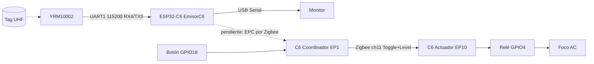

# CONTEXTO_PROYECTO — transferencia de contexto (humano / asistente IA)

Fecha de corte: 2026-11-24 · Rama `main` · Commit `3bbda7f`.
Regla de lectura: lo marcado **[HECHO]** está en el código; **[INFERIDO]** es deducción; **[DESCONOCIDO]** no hay información.
Detalle y hallazgos: ver `AUDITORIA_TECNICA.md`. Plan: `ROADMAP.md`.

## 0. ACTUALIZACIÓN 2026-11-24 — integración RFID↔Zigbee v1 (prevalece sobre lo que contradiga abajo)
Se implementó la primera versión de extremo a extremo (compila; **no probada en hardware**):
- `EmisorC6/EmisorC6.ino`: lector YRM10002 (mismos pines/baud/comando) + nodo Zigbee **End Device explícito** (= el rol efectivo del actuador del ejemplo, cuyo `begin()` sin argumento usa ese default). `loop()` solo lee UART; `zigbeeTask` inicia Zigbee y envía desde una cola de 8 (descarta el más antiguo). Dedupe 1 s; reenvía el inventario si el lector calla 5 s (resuelve A8); reinicia si no hay red en 180 s o falla `begin()` (A6/A7).
- `CoordinadorC6/CoordinadorC6.ino` (carpeta recreada, ahora receptor): `begin(ZIGBEE_COORDINATOR)`, canal 11, red abierta 180 s, EP1; callback → cola → impresión en `loop()`.
- Transporte: comando de cluster personalizado `0xFC10` / cmd `0x01`, unicast a `0x0000` EP1 (sin binding). Formato y limitaciones: `PROTOCOLO_RFID_ZIGBEE.md`. Pruebas y procedimiento: `PRUEBAS_RFID_ZIGBEE.md`; `bash tests/run_checks.sh`.
- Módulos: `yrm_parser.h` (parser extraído, mismo algoritmo + validaciones), `rfid_zigbee_protocol.h` y `rfid_zigbee_ep.h` (duplicados idénticos en ambas carpetas por limitación de Arduino).
- Los ejemplos originales en `Ejemplos/` no se modificaron. El usuario confirmó que ese ejemplo (coordinador+actuador, latidos) funciona en hardware; eso no se re-verificó aquí.
- **Validado en hardware con `RFID_SIMULATION_MODE = true`** (EPC ficticios 1/s, emisor→coordinador, `ORIGEN: SIMULADO`); `data.size` incluye el prefijo. Detalle en `PRUEBAS_RFID_ZIGBEE.md`. El coordinador imprime con `log_printf` (macro `DIAG`) porque `Serial` (UART0) no sale por el puerto USB nativo, mientras los logs del stack sí.
- Pendiente: lectura con etiquetas reales (`RFID_SIMULATION_MODE = false`; hay problemas de detección con la antena, ajeno a Zigbee), prueba de larga duración/recuperación, unidad del RSSI del lector, A3 (partición), A10 (pines de strapping GPIO4/5).
- El emisor tiene `RFID_SIMULATION_MODE` (constante al inicio de `EmisorC6.ino`, hoy `true`) que mete EPC ficticios en la misma cola; `FLAG_SIMULATED` = bit1 de `flags`.
- Flujo: tag → YRM10002 → UART1 (RX4/TX5) → parser → cola → Zigbee (EP10 → EP1 del coordinador) → Serial del coordinador.

### 0.1 Enlace Coordinador → LilyGO 7070 (trazabilidad) — implementado y compilado, **no probado en hardware**
- Basado en `Ejemplos/c6_lilygo` (auditado en `PROTOCOLO_C6_LILYGO.md`): **UART por hardware** 115200 8N1; C6 `Serial1` TX=GPIO10/RX=GPIO11; LilyGO `Serial2` RX=GPIO32/TX=GPIO33; texto ASCII, una línea por mensaje (`println`). El ejemplo no tenía ACK, validación ni recuperación; no documenta cableado (GND común) ni placa.
- `CoordinadorC6` además reenvía cada evento RFID válido al LilyGO con línea `$RFID,…*HH` (MSG ID original, EPC, RSSI lector, RSSI Zigbee, REAL/SIMULADO, NWK e IEEE del emisor, IEEE y sesión del coordinador, `tRxMs`/`tTxMs` = uptime del coordinador, estado V/D/G, `seq` del enlace). Anillo de 16 pendientes, escritura no bloqueante; el callback Zigbee no cambió; sin LilyGO el coordinador sigue operando.
- `LilyGoReceptor/LilyGoReceptor.ino` (nuevo): lectura no bloqueante, validación completa, detección de saltos/duplicados, ACK opcional, muestra el formato "RFID TRACEABILITY". `trace_link.h` duplicado idéntico en ambas carpetas; pruebas en `tests/trace_link_selftest.cpp`.
- Sin timestamp de lectura RFID (el emisor no lo envía); los tiempos son uptime del coordinador. Sin reintentos (v1).
- Emisor sin cambios en este paso. Compilar/validar: `bash tests/run_checks.sh`.

### 0.2 Publicación MQTT desde el LilyGO — implementado y compilado, **no probado con red celular/broker**
- Flujo completo: YRM10002 → emisor C6 → Zigbee `0xFC10` → coordinador C6 → UART → **LilyGO 7070 → MQTT (red celular) → broker**. El enlace RFID→Zigbee→coordinador→LilyGO ya se comprobó físicamente (LilyGO recibe y devuelve ACK).
- `LilyGoReceptor/LilyGoReceptor.ino` ahora publica cada evento válido. Réplica de `Ejemplos/lilygoTelcel` (auditado en `AUDITORIA_LILYGO_TELCEL.md`): TinyGSM SIM7070 + PubSubClient, módem en `Serial1` (GPIO26/27, PWR GPIO4), APN Telcel, broker público `broker.hivemq.com:1883` sin TLS ni credenciales MQTT, Client ID = IMEI, mismas pausas (180 s red / 10 s APN / 10 s MQTT). Configuración en `LilyGoReceptor/mqtt_config.h` (única copia; no se imprime ni se documenta el usuario/clave del APN).
- **Tópico fijo y exclusivo: `iot/prototipo-convergente/rfid/events`** (distinto del `GsmClientTest/<imei>/potenciometro` del ejemplo). QoS 0, `retain=false`. JSON documentado en `DISENO_MQTT_RFID.md` (`msgId`, `seq`, `epc`, `rssiReader`, `rssiZigbee`, `origin`, `status`, `senderNwk`, `senderIeee`, `coordinatorIeee`, `coordinatorSession`, `coordinatorRxUptime`, `coordinatorTxUptime`; sin IMEI ni hora absoluta).
- Arquitectura: `loop()` (UART, valida, muestra, **encola**, ACK) y `mqttTask` (core 1; único usuario del módem/MQTT). Cola en RAM de 32 eventos con mutex; llena = descarta el más antiguo (registra seq/MSG ID). **El ACK UART significa "línea válida recibida", no publicación MQTT; `publish()` true tampoco es confirmación del broker.**
- Cambios deliberados respecto al ejemplo: tarea separada en el core 1 (el core 0 tiene watchdog idle activo y TinyGSM no cede a la tarea idle), `setBufferSize(512)` (el JSON no cabe en 256 B), `retain=false`.
- Riesgo de seguridad vigente: broker público sin autenticación ni TLS (cualquiera puede leer/inyectar en el tópico).
- **Recepción MQTT** (compilada, sin probar con el broker): el LilyGO también se suscribe a `iot/prototipo-convergente/response` en cada conexión/reconexión MQTT (misma conexión, `mqtt.setCallback`, procesado en `mqtt.loop()` dentro de `mqttTask`) e imprime tópico, longitud, tipo y contenido (hex si no es texto UTF-8). No se republica ni se trata como evento RFID. Límite de PubSubClient: ≈ 470 B de payload. Ver `DISENO_MQTT_RFID.md` §10 y `PRUEBAS_MQTT_RFID.md`.
- **LEDs por MQTT** (compilado, sin probar con hardware): `true` → LED verde GPIO18 2 s; `false` → LED rojo GPIO19 2 s; cualquier otro payload se ignora; un mensaje nuevo reinicia los 2 s. Callback encola, `loop()` controla GPIO y `millis()` (sin `delay`). Lógica en `led_control.h`. Ver `DISENO_MQTT_RFID.md` §11.
- Pruebas: `bash tests/run_checks.sh` (incluye `tests/mqtt_json_selftest.cpp`); pendientes físicas en `PRUEBAS_MQTT_RFID.md`. Emisor, coordinador y ejemplos: sin cambios en esta etapa.

## 1. Resumen ejecutivo (estado al momento de la auditoría; ver sección 0)
Repositorio de prototipado IoT con ESP32-C6. Hoy contiene (a) un lector RFID UHF funcionando por UART que imprime EPC/RSSI por Serial, y (b) un ejemplo didáctico Zigbee de terceros (coordinador-interruptor + router-relé). **No están integrados.** El objetivo aparente (RFID → Zigbee → coordinador) es **[INFERIDO]**, no documentado.

## 2. Arquitectura


## 3. Hardware
- ESP32-C6 dev board (modelo exacto **[DESCONOCIDO]**), "ESP32C6 Dev Module" en IDE.
- Lector YRM10002 (UART 115200 8N1). Alimentación y cableado físico **[DESCONOCIDO]**.
- Grove Relay HLS8L-DC3V-S-C + foco AC (solo ejemplo; 110/220 V, ver precauciones en `Ejemplos/Zigbee_Rele-main/README.md`).

| Nodo | GPIO | Uso |
|---|---|---|
| EmisorC6 | 4 / 5 | UART1 RX / TX al lector |
| Coordinador lab | 18 | Botón (INPUT_PULLUP, activo LOW) |
| Actuador lab | 4 | Relé; `LED_BUILTIN`/15 LED |

Aviso: GPIO4/5/15 son pines de strapping del C6 (verificar datasheet de la placa).

## 4. Software y versiones
- Arduino IDE + core **esp32 (Espressif) 3.3.8** instalado localmente (el repo no lo fija). Librería `Zigbee` del core (ZBOSS / esp-zigbee-sdk). Sin PlatformIO/CMake/sdkconfig.
- Opciones de IDE según README del ejemplo: Board `ESP32C6 Dev Module`; Partition `Zigbee 4MB with spiffs` (ver duda A3: puede requerir `Zigbee ZCZR 4MB with spiffs`); Erase All Flash `Enabled`; Zigbee mode `ZCZR` (la opción "Zigbee Router" del README no existe en 3.3.8).

## 5. Estructura de archivos
```
EmisorC6/EmisorC6.ino                         Lector RFID (propio)
Ejemplos/Zigbee_Rele-main/README.md           Práctica de laboratorio (UAEH, terceros)
Ejemplos/Zigbee_Rele-main/Zigbee_Coordinador/Zigbee_Coordinador.ino
Ejemplos/Zigbee_Rele-main/Zigbee_Actuador/Zigbee_Actuador.ino
(borrado) CoordinadorC6/CoordinadorC6.ino     git show 594dbf2:CoordinadorC6/CoordinadorC6.ino
```

## 6. Componentes y responsabilidades
- **EmisorC6**: envía comando de inventario múltiple (10 000 rondas) `BB 00 27 00 03 22 27 10 83 7E`; parsea tramas `BB type cmd lenH lenL data checksum 7E` (longitud total = 7 + len); en `type=0x02 cmd=0x22` extrae RSSI (`frame[5]`), PC (`frame[6..7]`), EPC (`frame[8..]`, longitud `((PC>>11)&0x1F)*2`).
- **Zigbee_Coordinador**: `ZigbeeColorDimmerSwitch` EP1, `begin(ZIGBEE_COORDINATOR)`, canal 11, `setRebootOpenNetwork(180)`; botón → `lightToggle()`; cada 5 s `setLightLevel(1..254)` como "latido" (solo si `bound()`).
- **Zigbee_Actuador**: `ZigbeeDimmableLight` EP10, callback `onLightChange` acciona relé y registra latidos; aviso de pérdida tras 15 s sin latido. **Bug: `Zigbee.begin()` sin rol → End Device.**
- **Coordinador propio (borrado)**: `ZigbeeSwitch` EP1, modelo "RFID_Coord", reinicia ante fallo, imprime estado cada 2 s.

## 7. Configuraciones relevantes
- Canal Zigbee fijo 11 (`1<<11`) en ambos nodos. PAN ID / Ext PAN ID: automáticos. Seguridad: por defecto (no tocada).
- Persistencia de red del stack en `zb_storage`; "Erase All Flash" la borra en cada carga.
- Roles: elegidos por modo de compilación (ED / ZCZR) **y** por `Zigbee.begin(rol)`; no hay cambio dinámico.

## 8. Estado actual
- Funciona (según código, **no verificado en hardware**): lectura RFID; ejemplo lab (si se corrige rol/partición).
- No existe: integración RFID↔Zigbee, reporting, pruebas, documentación del proyecto propio.

## 9. Problemas conocidos (resumen; IDs en la auditoría)
A1 rol Router ausente (ALTO) · A2 README con opción inexistente (ALTO) · A3 partición posiblemente incorrecta (MEDIO) · A4 sin integración (ALTO) · A8 inventario RFID se agota (MEDIO) · A6/A7 esperas infinitas sin reinicio (MEDIO) · A10 strapping pins (MEDIO, sospecha).

## 10. Decisiones técnicas existentes
- Arduino-ESP32 en vez de ESP-IDF puro. Canal fijo para aislar equipos. Uso del cluster Level como canal de latido (decisión del material del curso). Red abierta 180 s tras cada arranque del coordinador.
- Nota de gobierno (CLAUDE.md corporativo): tecnologías nuevas requieren aprobación; el repo es un prototipo/POC personal, usar rama `poc/` y commits `[POC]` si se aplica el flujo FINDEP.

## 11. Pendientes
Ver `ROADMAP.md`. Preguntas abiertas: objetivo real, placa exacta, cableado/alimentación del lector, versión del core usada, resultados de pruebas previas, por qué se borró `CoordinadorC6`.

## 12. Próximos pasos recomendados
1. Fijar entorno reproducible (documentar versión de core y opciones).
2. Validar el ejemplo lab tal cual en hardware y guardar logs.
3. Corregir rol Router y partición en el Actuador y repetir.
4. Diseñar el paquete de datos RFID sobre Zigbee antes de codificar.

## 13. Comandos (referencia; no se ejecutaron en la auditoría)
Arduino IDE es el flujo documentado. Equivalente CLI (**[INFERIDO]**, requiere `arduino-cli`, que no se encontró instalado en PATH):
```bash
# Compilar (ejemplo coordinador; FQBN con opciones)
arduino-cli compile --fqbn esp32:esp32:esp32c6:ZigbeeMode=zczr,PartitionScheme=zigbee_zczr,EraseFlash=none \
  Ejemplos/Zigbee_Rele-main/Zigbee_Coordinador
# Cargar (ajustar COM)
arduino-cli upload  -p COMx --fqbn esp32:esp32:esp32c6:ZigbeeMode=zczr,PartitionScheme=zigbee_zczr Ejemplos/Zigbee_Rele-main/Zigbee_Coordinador
# Monitor
arduino-cli monitor -p COMx -c baudrate=115200
```
Los identificadores de menú (`ZigbeeMode`, `PartitionScheme`, `zigbee_zczr`) provienen de `boards.txt` del core 3.3.8. Para lector RFID: Serial 115200; ZigbeeMode=Disabled basta.
Orden de arranque del ejemplo: coordinador primero, luego actuador, esperar ~30 s antes de pulsar.
Recuperar coordinador propio: `git show 594dbf2:CoordinadorC6/CoordinadorC6.ino`.
