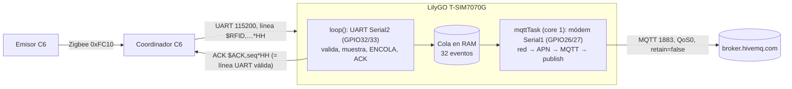

# Diseño: publicación MQTT de eventos RFID desde el LilyGO 7070

Estado: implementado y compilado en `LilyGoReceptor/LilyGoReceptor.ino`; **no probado con la red celular ni el broker** (ver `PRUEBAS_MQTT_RFID.md`). Fuente de la conexión: `Ejemplos/lilygoTelcel` (auditado en `AUDITORIA_LILYGO_TELCEL.md`).

## 1. Flujo


## 2. Qué se reutiliza del ejemplo y qué cambia
| Aspecto | Ejemplo | Este proyecto |
|---|---|---|
| Librerías | TinyGSM (SIM7070) + PubSubClient | **Las mismas** (0.12.0 / 2.8 instaladas) |
| Pines del módem | PWR=GPIO4, UART RX=26 TX=27, 115200 | **Idénticos** |
| Secuencia de arranque | pulso PWR 1 s → UART → 6 s → `restart()` → IMEI → `setNetworkMode(2)` → `setPreferredMode(3)` → `getOperator()` | **Idéntica** (dentro de `mqttTask`) |
| APN / broker / puerto / sin TLS / sin credenciales MQTT | ver auditoría | **Idénticos** (`mqtt_config.h`, única copia) |
| Client ID | IMEI | **IMEI** (no depende del tópico) |
| Lógica de conexión | red (`waitForNetwork` 180 s) → APN (pausa 10 s si falla) → MQTT (cada 10 s) | **Idéntica**, con `continue` en lugar de `return` |
| Tópico | `GsmClientTest/<imei>/potenciometro` | **Distinto y fijo**: `iot/prototipo-convergente/rfid/events` |
| Dónde se ejecuta | `loop()` (bloqueante) | **Tarea propia** (`mqttTask`, core 1) para no detener la UART |
| `retain` | `true` | **`false`** (justificado: flujo de eventos) |
| Buffer MQTT | 256 B por defecto | **512 B** (`setBufferSize`; el JSON del evento no cabe en 256) |
| Log | texto sin prefijo | prefijo `[MQTT]` y código de estado de PubSubClient al fallar la conexión |

## 3. Tópico
- **`iot/prototipo-convergente/rfid/events`**, constante `MQTT_TOPIC_EVENTS` en `LilyGoReceptor/mqtt_config.h`.
- Fijo: no aleatorio, no depende del IMEI/Client ID, sin comodines.
- **No reutiliza el del ejemplo** (`GsmClientTest/<imei>/potenciometro`): comprobado con `static_assert` en `tests/mqtt_json_selftest.cpp` (no empieza con `GsmClientTest`, no contiene `potenciometro`, sin `+`/`#`).
- **Advertencia**: el broker es público y sin autenticación (igual que el ejemplo). Cualquiera que conozca o adivine el tópico puede leer o **inyectar** eventos. El tópico es genérico; si se necesita aislamiento real, usar un broker privado con usuario/TLS o un prefijo único (cambio fuera del alcance actual).

## 4. Mensaje (JSON, UTF-8, QoS 0, `retain=false`)
Un mensaje por evento. Solo campos que ya existen en la línea UART; sin timestamps inventados.

```json
{"msgId":570,"seq":41,"epc":"E28068940000501234567AC9","rssiReader":-45,"rssiZigbee":-35,"origin":"REAL","status":"V","senderNwk":"0x1CB3","senderIeee":"1011121314151617","coordinatorIeee":"A0A1A2A3A4A5A6A7","coordinatorSession":"DEADBEEF","coordinatorRxUptime":577671,"coordinatorTxUptime":577690}
```
(Valores ilustrativos. Peor caso medido: 366 B con EPC de 32 B y valores máximos; con tópico y cabecera MQTT son 413 B, dentro de los 512 B configurados.)

| Campo | Origen | Notas |
|---|---|---|
| `msgId` | MSG ID original del emisor | sin modificar; **se reinicia a 1 si el emisor se reinicia** |
| `seq` | secuencia del enlace UART | la asigna el coordinador al encolar; se reinicia con cada arranque del coordinador (ver `coordinatorSession`) |
| `epc` | EPC completo en hex | 1–32 bytes |
| `rssiReader` | RSSI del lector | byte crudo como int8; unidad no verificada |
| `rssiZigbee` | RSSI del enlace Zigbee | medido en el coordinador |
| `origin` | `FLAG_SIMULATED` | `"REAL"` o `"SIMULADO"` |
| `status` | estado de validación del coordinador | `"V"` válido · `"D"` MSG ID repetido en Zigbee · `"G"` válido tras un salto de MSG ID |
| `senderNwk` | dirección NWK del emisor | puede cambiar si se reasocia |
| `senderIeee` | IEEE del emisor | `null` si el coordinador no pudo resolverla; no verificado en hardware |
| `coordinatorIeee` | IEEE del coordinador | `null` si desconocida |
| `coordinatorSession` | sesión aleatoria de arranque del coordinador | hex de 8 dígitos; identifica el "mundo" de `seq` y de los tiempos |
| `coordinatorRxUptime` | `millis()` del coordinador al recibir el mensaje Zigbee | **ms de uptime, no hora real** |
| `coordinatorTxUptime` | `millis()` del coordinador al serializar la línea | **ms de uptime, no hora real** |

Decisiones de contenido: **no se publica el IMEI ni el APN** (el broker es público); se añade `senderNwk` (los demás campos del listado ya estaban) porque es el único identificador de origen cuando la IEEE es `null`. No hay hora absoluta: el único reloj real disponible es el del suscriptor al recibir el mensaje. El JSON se construye con código propio (`rfid_json.h`, sin `String` ni ArduinoJson) y todos los valores son números, hex o enumeraciones fijas, por lo que no necesita escape (comprobado).

## 5. Qué confirma cada cosa (semántica)
| Señal | Qué confirma | Qué NO confirma |
|---|---|---|
| `ACK $ACK,<seq>*HH` (LilyGO → coordinador) | El LilyGO **recibió por UART** una línea **completa y válida** (checksum, campos, rangos). Se envía de inmediato. | Que el evento esté publicado, ni siquiera encolado con éxito para MQTT en todos los casos (la cola descarta el más antiguo si está llena). |
| Mensaje `[MQTT] Evento encolado…` | El evento entró a la cola en RAM. | Publicación. |
| `publish()` = true / `[MQTT] Publicado seq N` | PubSubClient **escribió** el paquete en el socket (QoS 0). | Que el broker lo recibiera o lo entregara (no hay PUBACK en QoS 0). |
| Mensaje visto por un suscriptor | Entrega real al broker y al suscriptor. | — |

Son operaciones independientes: el ACK **no** espera ni refleja MQTT.

## 6. Comportamiento ante fallos
| Situación | Comportamiento |
|---|---|
| Módem iniciando (≈ 6 s + `restart`) | La UART ya funciona (la inicialización va en `mqttTask`); los eventos se encolan. |
| Sin red celular | `mqttTask` espera `waitForNetwork(180 s)` y reintenta; `loop()` sigue recibiendo, mostrando, encolando y haciendo ACK. Estado `sin red celular`. |
| Sin datos (APN) | Pausa de 10 s entre intentos, como el ejemplo. |
| Sin MQTT | Intento cada 10 s (como el ejemplo). Los eventos permanecen en la cola. |
| Cola llena (32 eventos ≈ 4 min a 1 evento/8 s) | Se descarta el **más antiguo**, registrando su `seq` y MSG ID en el monitor; el contador `descartados_cola` sube. Nunca bloquea la UART. |
| `publish()` falla con la conexión caída | El evento **se conserva** y se reintenta tras reconectar. |
| `publish()` falla con la conexión activa | Se reintenta; tras 3 fallos seguidos se descarta ese evento (para no atascar la cola) y se cuenta como `abandonados`. |
| Duplicado de enlace (mismo `seq`) | Se muestra pero **no se vuelve a publicar**. |
| Reinicio del LilyGO | La cola está en RAM: **se pierden los eventos pendientes** (sin persistencia, por requisito). |

## 7. Concurrencia
- `loop()` (core 1): solo UART (`Serial2`), consola y cola. Nunca toca `modem`/`mqtt`.
- `mqttTask` (core 1, prioridad 1): único usuario de `modem`, `Serial1` y `mqtt`. **Se fija al core 1 a propósito**: el core 0 tiene el watchdog de la tarea idle activo (5 s, panic) y TinyGSM espera con `delay(0)`, que no cede a la tarea idle; en el core 1 (donde corría el ejemplo) no hay ese riesgo.
- Cola: anillo de 32 `Event` con **mutex** (secciones críticas = copiar una estructura). El consumidor publica una copia de la cabeza y solo la retira si sigue siendo ese mismo evento (`seq` + `sesión`); así el descarte del productor nunca provoca que se elimine un evento sin publicar.
- Contadores: un solo escritor cada uno; el estado de fase lo escribe solo `mqttTask`.

## 8. Credenciales y seguridad
- APN y broker se copiaron del ejemplo a `LilyGoReceptor/mqtt_config.h` (**única copia en este firmware**). Son valores genéricos del operador y un broker público sin autenticación; no hay secretos propios. **No se imprimen en logs ni se copian a documentos** (el log muestra tópico, broker, puerto y estado).
- Si en el futuro se usan credenciales reales: sacar `mqtt_config.h` del control de versiones y dejar una plantilla.
- Riesgos heredados (ver §3 de `AUDITORIA_LILYGO_TELCEL.md`): sin TLS ni autenticación; el EPC viaja en claro por un broker público.

## 9. Limitaciones
- Sin persistencia; sin QoS > 0; sin confirmación del broker.
- Sin timestamp absoluto; los tiempos son uptime del coordinador.
- Un solo hilo de eventos y un solo emisor soportado en la detección de saltos del coordinador.
- La pulsación de `PWR_PIN` al arrancar es la del ejemplo y podría apagar un módem ya encendido (no verificado).

---

## 10. Recepción MQTT (tópico `iot/prototipo-convergente/response`)

Estado: implementado y compilado; **no probado con el broker real**.

- **Suscripción**: constante `MQTT_TOPIC_RESPONSE` (`mqtt_config.h`), QoS 0, en la **misma conexión** MQTT (mismo módem, broker, puerto y Client ID). Se ejecuta **justo después de cada `mqttConnect()` exitoso**, es decir, en la primera conexión y en cada reconexión (la sesión es *clean*: el broker olvida las suscripciones al caer la conexión). Si `subscribe()` devuelve `false`, se reintenta cada 10 s mientras haya conexión (`[ESTADISTICAS MQTT RX]` muestra `suscrito=si|no`). `subscribe()` true significa "SUBSCRIBE escrito en el socket"; PubSubClient no expone el SUBACK.
- **Callback** (`onMqttMessage`, registrado con `mqtt.setCallback`): lo invoca PubSubClient **dentro de `mqtt.loop()`**, que ya se llamaba continuamente en `mqttTask`; por tanto nunca corre en `loop()` (UART/RFID) y no la retrasa. Imprime: **tópico**, **longitud en bytes**, **tipo** y **contenido**.
- **Qué NO hace**: no encola, no publica y no trata el mensaje como evento RFID. No toca el tópico `iot/prototipo-convergente/rfid/events` (comprobado con `static_assert`: los dos tópicos son distintos y la suscripción no usa comodines, así que el LilyGO no recibe sus propios eventos).
- **Contenido que no es texto JSON** (`mqtt_rx.h`, probado con `static_assert`):

| Tipo detectado | Criterio | Qué se imprime |
|---|---|---|
| VACIO | longitud 0 | `Contenido: (vacio)` |
| TEXTO (parece JSON, sin validar) | UTF-8 válido sin controles (salvo `\t \r \n`) y empieza con `{`/`[` y termina con `}`/`]` | el texto completo |
| TEXTO (no parece JSON) | UTF-8 válido sin controles | el texto completo |
| BINARIO / no es texto UTF-8 | UTF-8 inválido (incompleto, sobrelargo, sustitutos, > U+10FFFF), NUL, ESC u otros controles | **volcado hexadecimal** (máx. 64 bytes, indicando el total); no se escribe crudo para no enviar controles/escapes al terminal |

  "Parece JSON" es solo una heurística de presentación: **no se valida ni se interpreta el JSON**.
- **Límite de tamaño**: PubSubClient **descarta en silencio** los paquetes que no caben en su buffer de 512 B (≈ **470 B de payload** con este tópico); el callback no se invoca y no hay forma de detectarlo desde el firmware.
- **Mensajes retenidos**: si alguien publica con `retain`, el broker los reenvía en **cada suscripción** (cada reconexión); el callback de PubSubClient 2.8 no informa si el mensaje es retenido.
- **Seguridad**: broker público sin autenticación: **cualquiera puede publicar** en `…/response` y el contenido aparecerá en el monitor. No se actúa sobre él (solo se imprime), pero no debe usarse para tomar decisiones sin autenticación.
